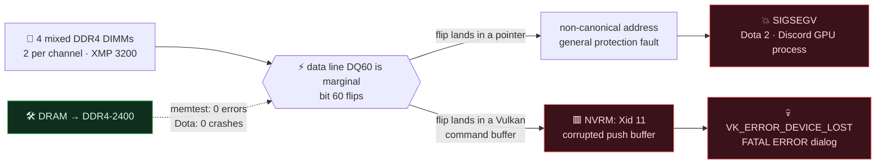
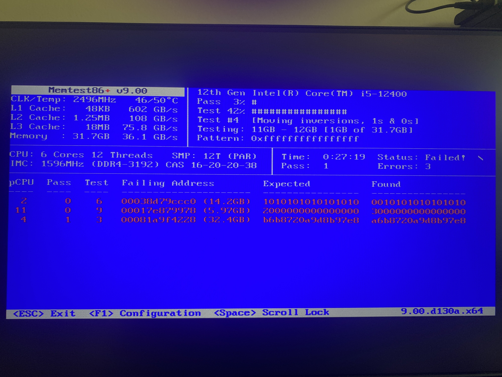
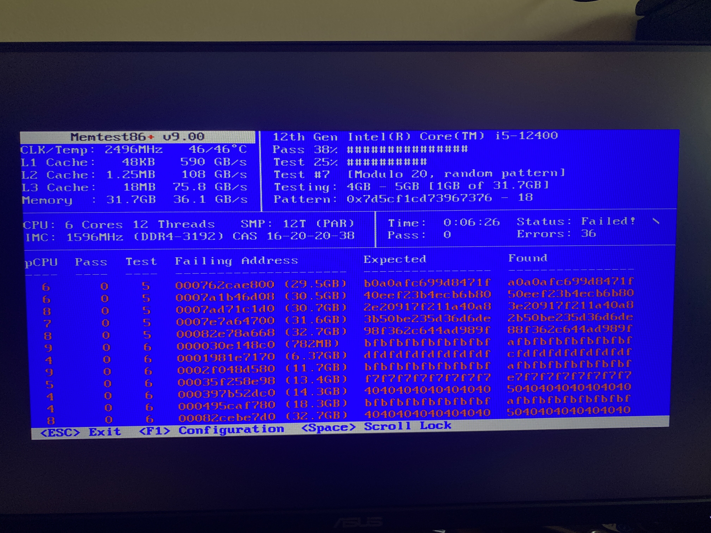
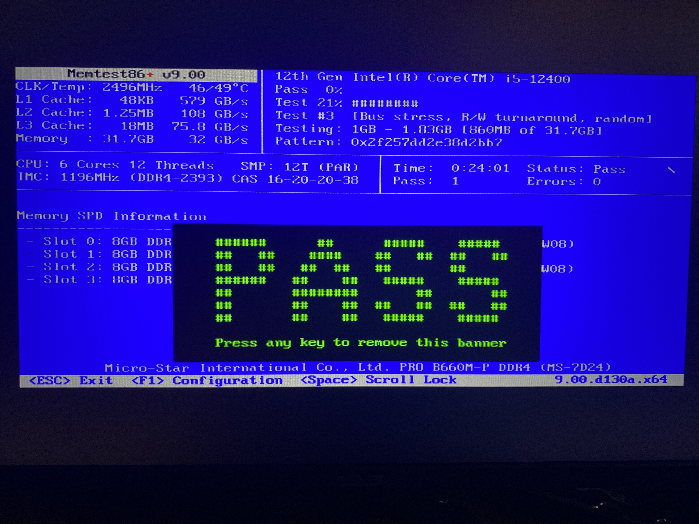

<p align="center">
  
</p>

<p align="center">
  
  
  
  
  <br>
  
  
  
  
  <br>
  
  
  
</p>

<h3 align="center">A crash investigation, from "Vulkan error, device lost" to a single failing wire on the memory bus.</h3>

---

> [!IMPORTANT]
> **TL;DR:** Dota 2 kept crashing on Linux with `VK_ERROR_DEVICE_LOST` and random segfaults. Neither the GPU, the NVIDIA driver,
> Vulkan, Wayland nor the game was to blame. Four mixed DDR4 sticks running XMP 3200 flipped **bit 60** of 64-bit words in RAM.
> A flip in a pointer gives a segfault. A flip in a Vulkan command buffer gives `NVRM: Xid 11` and then `DEVICE_LOST`.
> **Fix: run the RAM at DDR4-2400.** memtest86+ then passes a full pass with 0 errors, and Dota ran a full match
> (~70 min, plus ~40 min of all-core shader compiling) with **zero crashes** and higher GPU load than before.

<table>
<tr>
<td width="25%" align="center"><h1>🎮 8</h1>Dota crashes captured or recovered<br><sub>11-25 to 11-27, plus a history back to 10-02</sub></td>
<td width="25%" align="center"><h1>🧬 bit 60</h1>the same bit, every time<br><sub>in crash pointers <i>and</i> in memtest</sub></td>
<td width="25%" align="center"><h1>✅ 0</h1>memtest errors at DDR4-2400<br><sub>vs 36 errors in 6½ min at 3200</sub></td>
<td width="25%" align="center"><h1>🛡️ 0</h1>crashes in game at DDR4-2400<br><sub>~1 h 50 min of load vs 4 crashes in ~50 min at 3200</sub></td>
</tr>
</table>

## 📑 Contents
- [Is this you?](#-is-this-you) · [The one-bit story](#-the-one-bit-story) · [How it was caught](#-how-it-was-caught)
- [Evidence: crash cores](#-evidence-crash-cores) · [Evidence: memtest86+](#-evidence-memtest86) · [Ruled out](#-ruled-out)
- [The fix](#-the-fix) · [Diagnose your own machine](#-diagnose-your-own-machine) · [Repository map](#-repository-map)

---

## 🩺 Is this you?

You may be looking at the same problem if you see any of these on Linux, in **Dota 2, Counter-Strike 2** or any other Vulkan game:

```text
FATAL ERROR: Vulkan encountered unrecoverable error VK_ERROR_DEVICE_LOST.
ERROR! VK call failed! result = VK_ERROR_DEVICE_LOST ( vkQueueSubmit( pQueue, 1, &submitInfo, pFence->Get() ) )
dota.sh: line 118: 42432 Segmentation fault      (core dumped)
NVRM: Xid (PCI:0000:01:00): 11, pid=116325, name=dota2, channel 0x00000027 Cl 0000c797 Off 0000072c Data 200201cd
traps: GlobPool/4[42441] general protection fault ip:7fc9ae0de53b sp:7fca05b7d100 error:0 in libscenesystem.so
```

**…and especially if other programs (Discord, browsers) also segfault now and then.** That combination points away from the
GPU and toward system memory. CS2 runs on the same Source 2 Vulkan renderer, so it is exposed to the same corruption.
Dota simply hit it most often here.

---

## 🧬 The one-bit story

Here is one of the crashes, read straight out of the core dump with gdb:

```text
what the game stored   0x0000_02a7_e7cf_3820    ← a normal heap pointer
what the game read     0x1000_02a7_e7cf_3820    ← the same pointer, one bit different
                         ↑
                         bit 60  (binary 0000 → 0001 in the top nibble)

0x1000… is not a valid x86-64 address  →  general protection fault  →  SIGSEGV (si_code SI_KERNEL)
```

And here is memtest86+ catching the same bit, with no OS, no driver and no game running:

```text
expected  2000000000000000        expected  4040404040404040        expected  b6b8720a9d8b97e8
found     3000000000000000        found     5040404040404040        found     a6b8720a9d8b97e8
          ↑ bit 60                          ↑ bit 60                          ↑ bit 60
```

One root cause, two symptoms:



---

## 🔎 How it was caught

| # | Clue | Source | What it told us |
|:-:|---|---|---|
| 1 | Crashes, but **no `NVRM: Xid`** in 30 days of kernel logs | `journalctl -k` | The GPU wasn't faulting on its own |
| 2 | The faulting module differed every time: `libscenesystem`, `libpanorama`, `libclient`, `libc` | systemd-coredump | Not one buggy code path |
| 3 | Every bad pointer = **valid pointer + one high bit** (bit 60, twice bit 62) | gdb on the cores | Classic hardware bit-flip signature |
| 4 | GPU 62–67 °C, 180–262 W of 390 W at the crashes (session max 71 °C / 302 W), no thermal/power throttling, PCIe gen4 x16 | `nvidia-smi` every 1 s | Not heat, not power, not the bus |
| 5 | `DEVICE_LOST` arrived with **Xid 11, corrupted push buffer** | live kernel log | The GPU was *fed* garbage; it didn't produce it |
| 6 | **Discord's GPU process** crashed with the same signature (`0x4000…` + pointer) | coredump | Not Dota-specific: system-wide |
| 7 | Crash dumps date back to **10-02**, before the `gpu-unlock` module (10-27) | Steam logs | The GPU unlock module is not the cause |
| 8 | **4 sticks, 2 brands, mixed in each channel, XMP 3200** | `dmidecode` | Prime suspect |
| 9 | memtest86+ at 3200: **FAIL, every readable error on bit 60** | memtest86+ | ✅ Confirmed |
| 10 | memtest86+ at 2400: **PASS, 0 errors** | memtest86+ | ✅ Fix found |
| 11 | Dota at 2400: a full match (~70 min) + ~40 min of all-core shader compiling, **0 crashes**, GPU up to 74.5 °C / 378 W | `capture.sh` session 2 | ✅ Fix verified |

---

## 🧾 Evidence: crash cores

<details open>
<summary><b>Bit-flip crashes (gdb, registers at the faulting instruction)</b></summary>

| When (2026-11-27) | Process · thread | Faulting module | Instruction | Value used | Flip |
|---|---|---|---|---|:-:|
| 00:44 | dota2 · main | `libclient.so` | `call *%r9` | `0x10007f34ff60d1e0` | **60** |
| 14:07 | dota2 · `GlobPool/4` | `libscenesystem.so` | `movzwl 0x14(%r9)` | `0x100002869afbe000` | **60** |
| 14:14 | Discord · `VizCompositorThread` | Discord (Chromium GPU process) | `mov 0x10(%rbx)` | `0x40002944048b36c0` | **62** |
| 14:23 | dota2 · `GlobPool/3` | `libpanorama.so` | `lock subl $1,0x8(%rdi)` | `0x100002a7e7cf3820` | **60** |
| 14:26 | dota2 · `VKRenderThread` | `libc` ← `librendersystemvulkan.so` | memcpy-like | `0x400002efb0abf290` | **62** |

</details>

<details open>
<summary><b>Device-lost crashes</b></summary>

| When | What | Kernel |
|---|---|---|
| 11-27 00:46 | `vkQueueWaitIdle` / `vkQueueSubmit` → `VK_ERROR_DEVICE_LOST` → `Plat_FatalError` on `VKRenderThread` | (no Xid logged) |
| 11-27 14:48 | In-match `FATAL ERROR … VK_ERROR_DEVICE_LOST` dialog | `NVRM: Xid 11` on class `c797` (Ampere 3D) |

</details>

Full per-crash write-up: [`2026-11-27_session1/NOTES.md`](2026-11-27_session1/NOTES.md).
Raw gdb output: `2026-11-27_session1/gdb-core-*.txt`.

---

## 🧪 Evidence: memtest86+

| Run | RAM speed (memtest IMC line) | Duration | Errors | Bits | Verdict |
|:-:|---|---|:-:|---|:-:|
| [1](2026-11-27_memtest/RESULTS.md) | DDR4-3192 · XMP on | 27 min | 3 | all bit 60 | ❌ |
| [2](2026-11-27_memtest-xmp-off/RESULTS.md) | DDR4-3192 · "XMP off" (speed stayed, voltage likely dropped) | 6½ min | **36** | every readable one bit 60 | ❌ |
| [3](2026-11-27_memtest-2400/RESULTS.md) | **DDR4-2393** · manual 2400 | 24 min · 1 full pass | **0** | none | ✅ |

<table>
<tr>
<td align="center"><a href="2026-11-27_memtest/IMG_5483.jpg"></a><br><sub>Run 1 · 3200 · 3 errors</sub></td>
<td align="center"><a href="2026-11-27_memtest-xmp-off/IMG_5485.jpg"></a><br><sub>Run 2 · still 3200 · 36 errors</sub></td>
<td align="center"><a href="2026-11-27_memtest-2400/IMG_5491.jpg"></a><br><sub>Run 3 · 2400 · PASS</sub></td>
</tr>
</table>

> [!WARNING]
> On this MSI board, **turning A-XMP off did not lower the RAM speed.** It stayed at 3200 and the errors got *worse*.
> Always check the `IMC: … (DDR4-xxxx)` line in memtest86+ to see the speed you are really running.

---

## 🚫 Ruled out

| Suspect | Verdict | Why |
|---|:-:|---|
| NVIDIA driver / GPU hardware | ❌ | memtest fails with no driver loaded; only one Xid, and it is the "bad input" kind |
| GPU heat / power / PCIe | ❌ | 62–67 °C and ≤ 262 W of 390 W at the crashes, no thermal/power throttle, gen4 x16 throughout. At 2400 the GPU ran hotter (74.5 °C, 378 W) with no crash |
| CPU heat | ❌ | package ≤ 69 °C for the whole session |
| Dota 2 / Source 2 bug | ❌ | Discord crashed the same way; memtest reproduces it without any game |
| Vulkan / Wayland / niri / xwayland | ❌ | Nothing to do with the memory bus |
| Skipped shader pre-cache | ❌ | Crashes happened either way |
| `gpu-unlock` DKMS module (FP16/BF16 unlock) | ❌ | Crashes predate it by 3+ weeks; memtest runs without it |

---

## 🛠️ The fix

```text
BIOS (MSI PRO B660M-P)  →  F7 Advanced  →  OC  →  DRAM Frequency = DDR4-2400   (timings/voltage Auto)
```

<details>
<summary><b>Hardware in question</b></summary>

| Slot | Module | Size | Was running at |
|---|---|---|---|
| A1 | Kingston FURY Beast `KF3200C16D4/8GX` | 8 GB | 3200 (XMP) |
| A2 | Corsair Vengeance LPX `CMK8GX4M1E3200C16` | 8 GB | 3200 (XMP) |
| B1 | Kingston FURY Beast `KF3200C16D4/8GX` | 8 GB | 3200 (XMP) |
| B2 | Corsair Vengeance LPX `CMK8GX4M1E3200C16` | 8 GB | 3200 (XMP) |

i5-12400 (Alder Lake) · MSI PRO B660M-P DDR4 · RTX 3090 · CachyOS, kernel 7.3.5 · niri 26.04 · nvidia-open 620.73.04.
Two kits from two vendors share each channel, 2 DIMMs per channel, on XMP. That is a tough load for the memory controller.

</details>

**Cost of the fix:** memtest bandwidth went from 36.1 to 32 GB/s. With an RTX 3090 as the limit in Dota, this is hard to notice.

### Status
- [x] Root cause found in the crash cores (bit 60 / bit 62 pointer flips)
- [x] Confirmed by memtest86+ at 3200 (FAIL, bit 60)
- [x] memtest86+ at 2400: 1 full pass, **0 errors**
- [x] **In-game verification:** full match at 2400 with [`capture.sh`](capture.sh) running: no segfault, no Xid, no coredump
  ([session 2 notes](2026-11-27_session2/NOTES.md))
- [ ] Optional: win back speed, 2666 → 2933 at 1.35 V, each step memtest-clean; or test each kit alone at 3200

---

## 🧰 Diagnose your own machine

These scripts were written for this investigation and work on any systemd + NVIDIA + Steam Linux box.

```bash
# 1. Record everything while you play (journal incl. kernel, GPU telemetry every second,
#    game stdout, process start/exit times, CPU temps). Ctrl+C to stop.
./capture.sh 2026-11-28_session2

# 2. After a crash: dump registers and look for a pointer with one stray high bit
./analyze-core.sh <pid> <session-dir>
#   --- registers with a stray high bit (bit-flip candidates)
#   rdi  0x100002a7e7cf3820  ...      ← this is what a RAM bit flip looks like

# 3. Add memtest86+ to GRUB (Arch/CachyOS, EFI, ESP at /boot/efi)
sudo bash setup-memtest-grub.sh
```

Quick checks, no scripts needed:

```bash
journalctl -k -b | grep -E 'NVRM: Xid|general protection'   # Xid 11/13/31 or GP faults?
coredumpctl list                                              # more than one program crashing?
```

---

## 🗂️ Repository map

```text
.
├── README.md                       ← you are here
├── handout.md                      ← hand-off: what was done, next steps (start here to continue)
├── capture.sh                      ← live capture while playing
├── analyze-core.sh                 ← core dump → registers → bit-flip check
├── setup-memtest-grub.sh           ← memtest86+ EFI + GRUB entry
├── assets/banner.svg
├── 2026-11-27_session1/            ← live capture session: 4 crashes, gdb output, GPU/CPU telemetry, NOTES.md
├── 2026-11-27_session2/            ← verification at 2400: full match, 0 crashes (NOTES.md + telemetry)
├── 2026-11-27_memtest/             ← run 1 · 3200 · FAIL (photos + RESULTS.md)
├── 2026-11-27_memtest-xmp-off/     ← run 2 · still 3200 · FAIL
└── 2026-11-27_memtest-2400/        ← run 3 · 2400 · PASS
```

<details>
<summary><b>Side quests (found along the way, not the cause)</b></summary>

- Steam's zenity error dialog fails (`libgtk-3.so.0: undefined symbol: pango_font_family_get_face`), so the game hangs on
  the in-game fatal dialog and has to be killed.
- The `-dx11` launch option does nothing on Linux, where Dota is Vulkan-only.
- The kernel cmdline carries `gpu_unlock.targets=0000:01:00.0`, from the owner's own FP16/BF16 unlock module. It was
  investigated and cleared (see Ruled out).

</details>

<details>
<summary><b>Privacy</b></summary>

Raw captures (full system journal, Steam logs, minidumps) contain the Steam ID, LAN IPs and MAC addresses, email addresses
and process memory. They stay local (`.gitignore`); everything they proved is quoted in the notes. Photos had EXIF/GPS
stripped, and Machine/Boot IDs were removed from the coredump summaries.

</details>

<p align="center"><sub>Investigated on CachyOS, 2026-11-27 · one bit, two symptoms, zero GPU faults.</sub></p>
